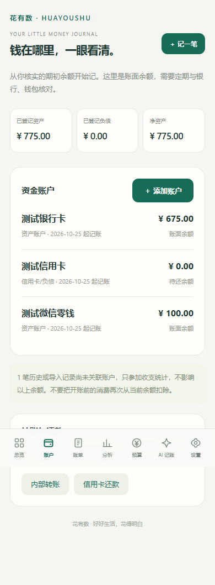
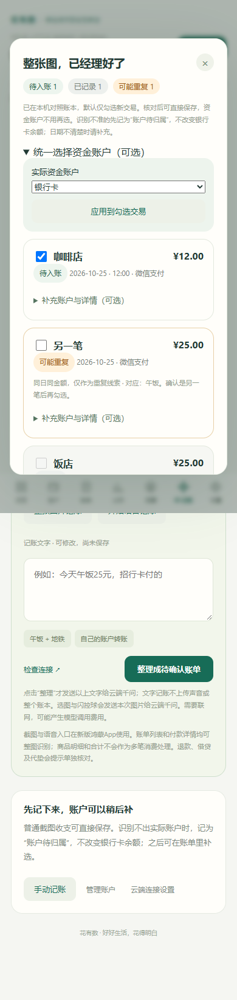
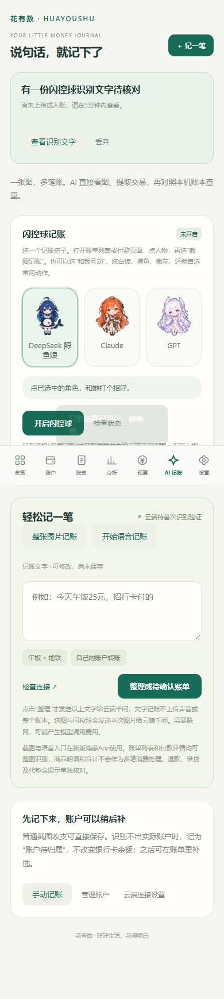

# 花有数

本地保存账本的记账应用，包含网页版、HarmonyOS 工程和可自行部署的千问 AI 网关。当前源码版本为 **2.3.3**，仍处于开发阶段，尚非应用商店发行版。

<p align="center">
  
  
  
</p>

> 截图均为演示账本与测试账户，不含真实账单数据。

## 能做什么

- **一张图，多笔账**：将主动选择或截取的图片交给云端千问，提取交易金额、日期、商户等信息。
- **本机查重**：对照本地账本区分新记录、已记录和可能重复的记录；勾选后保存。
- **先记账，再补账户**：普通收入、支出无需先建立资金账户。账户不明确时标为“账户待归属”，参加收支统计，但不扣减任何实际银行卡或钱包余额；后续可在原账单上补充账户。
- **语音记账**：HarmonyOS 端采集语音并转成文字，再由 AI 整理成待确认账单。
- **复式分录**：从交易生成平衡的借贷记录，支持资金账户、期初余额、内部转账和信用卡还款；内部转账和还款仍需核对双方账户。
- **预算与备份**：日、周、月统计，应用内预算提醒，JSON 完整备份及微信账单 CSV 导入。
- **人物入口与互动**：闪控球展开截图和互动菜单；14种本地动作，可自选2–6个常用动作。互动不截图、不调用云端模型。

## 已知限制

**截图后自动返回应用尚未可靠实现。** 真机调用遇到系统错误码 `801` / `201`，不能把该流程描述成“一键截图后必定自动回应用”。遇到无法返回时，请手动打开花有数查看识别状态，或使用应用内选图入口。普通截图收支的勾选保存流程会返回首页，但这与跨应用截图后的系统窗口恢复是两件事。

目前不监听付款完成事件，不自动读取微信、支付宝或银行卡流水；未接入小艺或可代替用户操作其他应用的 Agent。模型可能识别错误，日期缺失或疑似重复的交易仍需核对。网页版不提供鸿蒙系统闪控球和原生语音采集功能。

## 快速启动网页版

需要 Node.js 20 或更高版本。在项目根目录运行：

```sh
npm ci
npm start
```

打开 [本地页面](http://127.0.0.1:4173)。首次使用按界面设置预算；手工记账、统计和本地备份不要求 AI 已配置。

默认服务使用 Ollama 文字模型配置，未安装或启动 Ollama 时仍可使用手工记账。当前默认模型为 `qwen2.5:1.5b`，可通过 `OLLAMA_MODEL` 调整。图片识别使用另行配置的云端视觉网关，不由这个默认本地文字模型处理。

开发服务监听 `0.0.0.0:4173`，便于同一局域网设备连接；请勿直接把该开发端口暴露为公共服务。

## 接入云端千问

仓库提供网关代码，不提供共享 API Key、连接码或可直接使用的公共服务。

1. 按 [云端部署说明](cloud/部署说明.md) 部署自己的 HTTPS 网关。
2. 在服务器设置百炼 Key、应用连接令牌、文字模型和视觉模型。
3. 在应用“设置 → AI 连接”填写自己的 HTTPS 服务地址和应用连接码。

百炼 API Key 留在服务器。手机保存的是本应用连接码。文字记账发送本次文字，图片记账发送本次压缩图片；查重使用的完整账本留在本机。模型服务可能计费，额度和可用模型以部署者的服务配置为准。

## 构建 HarmonyOS 应用

需要 DevEco Studio、HarmonyOS API 26 SDK、兼容设备，以及开发者自己的签名与正式权限配置。详见 [HarmonyOS 工程说明](harmonyos/README.md)。

先把网页资源打入原生工程：

```sh
npm run package:harmony
```

再用 DevEco Studio 打开 `harmonyos/` 构建和签名。仓库不提供开发者私钥、证书、设备专属 Profile 或预先获批的闪控球权限。系统能力、权限审核及运行时用户授权均以华为官方流程为准。

## 测试

```sh
npm test
```

这组测试覆盖账本、借贷分录、导入和 AI 输出校验，不会向真实账本写入测试记录，也不调用付费模型。网页交互和鸿蒙生命周期另有测试脚本；模拟测试不能替代设备上的权限、窗口恢复和识别验收。

## 数据保存

账本保存在当前浏览器或应用的本地存储中，手机和电脑之间不会自动同步。定期导出 JSON 备份；清除浏览器数据、卸载应用或清除应用数据可能丢失账本。CSV 导出用于查看，完整恢复请使用 JSON。

## 目录

| 路径 | 内容 |
| --- | --- |
| `web/` | 页面、账本核心、查重和离线资源 |
| `harmonyos/` | 原生桥、截图、语音、闪控球与互动页面 |
| `server.cjs` | 文字/图像记账网关与本地开发服务 |
| `cloud/` | 云端打包脚本及部署示例 |
| `tests/` | 账本与接口、页面测试 |
| `licenses/` | 保留的第三方许可证和来源声明 |

## 许可与素材

本项目自有代码采用 [MIT License](LICENSE)。第三方依赖和人物素材不因位于本仓库就自动改用 MIT；适用范围见 [许可范围](LICENSE_SCOPE.md) 和 [第三方归属](THIRD_PARTY_NOTICES.md)。

鲸鱼娘使用 `dsh-pet` 的衍生帧；GPT、Claude 角色是根据参考图生成的 AI 衍生形象。它们并非相关公司的官方角色或授权产品。本仓库不声称拥有原始角色设计或品牌权利，也不承诺这些角色素材可按项目代码许可自由再授权。
